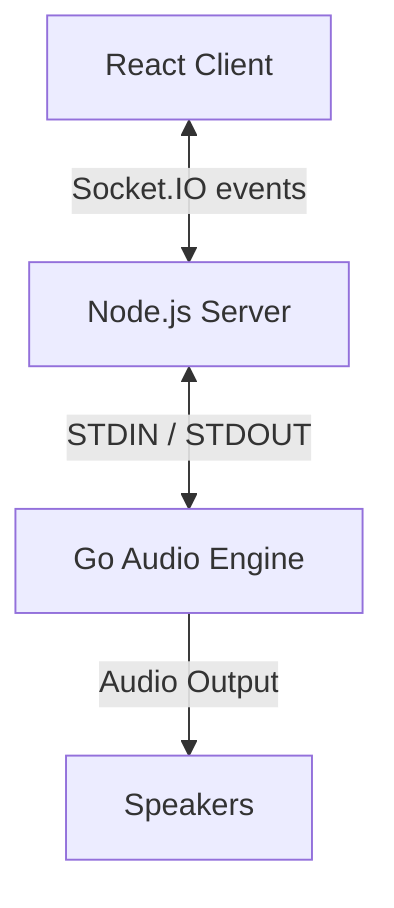

# HarmonySync Audio Service Architecture

## Overview
The Audio Service provides high-performance multitrack audio playback using a hybrid architecture:
- **Frontend**: React application using `RemoteAudioMixer` to communicate via Socket.IO.
- **Middleware**: Node.js service (`server.ts`) managing state and coordinating the backend.
- **Backend (Engine)**: GoLang executable (`audio-engine.exe`) handling real-time audio decoding, mixing, and playback.

## Component Interaction

## Preloading Mechanism (Multiple Songs)
To ensure gapless playback, the system supports loading multiple songs into memory.

1.  **Trigger**: Frontend (`ServiceOrderViewModel`) identifies the next song.
2.  **Request**: `RemoteAudioMixer` emits `preload_song` event with track paths.
3.  **Orchestration**: Node.js `AudioMixer` calls `GoEngineAdapter.loadSongTrack` for each track.
4.  **Buffering**: Go Engine decodes and stores audio in memory (`beep.Buffer`) under a specific `SongID`.
5.  **Activation**: When the user clicks the next song, frontend emits `switch_song`.
6.  **Switch**: Go Engine instantly swaps the active mixer input to the preloaded song tracks.

## Commands (JSON-RPC to Go Engine)
The Node.js service sends newline-delimited JSON commands to the Go process STDIN:

- `load`: Load a track (legacy/single mode)
- `play`, `pause`, `stop`: Playback controls
- `setVolume`, `setPan`, `setMute`: Track controls
- `loadSongTrack`: Load a track for a specific Song ID (Background)
- `activateSong`: Make a Song ID active (Instant)
- `clearSong`: Free memory for a Song ID

## Files
- `server.ts`: Entry point, Socket.IO handlers.
- `audioMixer.ts`: Logic layer, manages Song/Track state.
- `goEngineAdapter.ts`: Spawns and communicates with `audio-engine.exe`.
- `go-engine/`: Source code for the Go backend.
